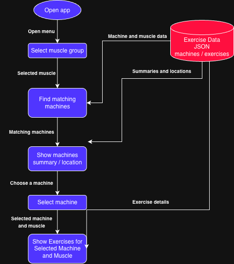

# CoRec Muscle-to-Machine Finder

## Project goal
When machines at the CoRec are busy, finding another way to train the same muscle can be difficult. This Java desktop app will let users select a muscle group, browse matching machines with summaries and locations, and click a machine to see exercises for that muscle.

## Status
Planning stage for the CS193 final project. The application has not been implemented yet.

## MVP scope
- Select a muscle group, such as biceps.
- Display matching machines with a short summary and location in the CoRec.
- Click a machine to view exercises for the selected muscle.
- Load a small, manually curated collection from a local JSON file.

Users will check equipment availability themselves. The app will not track live occupancy.

## Future plans
- Click a muscle on a body diagram instead of selecting it from a menu.
- Add exercise pictures and more detailed instructions.
- Add a visual gym map showing machine locations.
- Explore a phone-friendly version.
- Explore a phone-friendly version.

## Planned tech stack
- Java: application logic.
- JavaFX: desktop interface, layouts, and image display.
- Gson: reading local JSON data.
- JSON file: machine names, summaries, locations, muscles, and exercises.
- Maven: dependency management and builds.
- Git and GitHub: version control and documentation.

No external API or database is required. Machine locations will be recorded manually and checked at the CoRec. Exercise information will be curated manually, with sources recorded alongside the data.

## Project structure
```text
src/main/java/       Java application source
src/main/resources/  Local JSON data and other app resources
src/test/java/       Tests for matching logic
docs/               Planning documents and diagrams
```
The source folders currently contain placeholders. Build configuration and runnable code will be added during implementation.

## Build milestones
Each milestone will be completed and committed separately as development progresses.

1. Configure the Maven project with JavaFX and Gson; verify a basic window opens.
2. Create the local JSON collection of machines, locations, target muscles, and exercises.
3. Add Java data classes and load the JSON file with Gson.
4. Add muscle selection and matching-machine logic.
5. Display matching machine summaries and locations, including an empty-results message.
6. Make each machine clickable and display exercises for the selected machine and muscle.
7. Polish the interface and test the complete selection workflow; fix issues found.
8. Update the README with run instructions, screenshots, and known limitations.

## Planning documents
- [Project design](docs/project-design.pdf)
- [Eisenhower matrix PDF](docs/eisenhower-matrix.pdf)
- [Eisenhower matrix text](docs/eisenhower-matrix.md)
- [Editable system diagram](docs/system-diagram.drawio)


